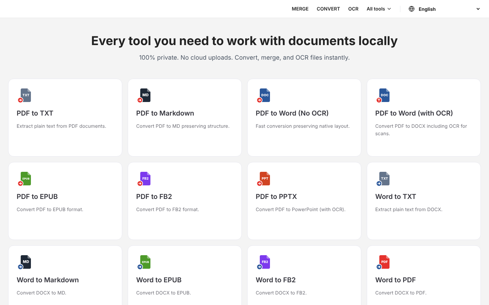

# Local Doc Suite

[](https://github.com/danylo-smilhain/local-doc-suite/actions/workflows/ci.yml)

A local document converter. A React web interface and a Python (FastAPI) backend
run on your own machine in Docker and convert documents, e-books, images and
video between formats. Files never leave your computer.

## Screenshot



## Requirements

- [Docker](https://docs.docker.com/get-docker/) with Docker Compose

## Run

```sh
docker compose up --build
```

Then open http://127.0.0.1

## Supported file formats

Taken from the backend routing table (`backend/app/convert.py`) and the
accepted upload types (`backend/app/models.py`).

**Upload types:** PDF, DOCX, DOC, ODT, RTF, PPTX, PPT, ODP, XLSX, XLS, ODS,
HTML/HTM, MD/Markdown, TXT, EPUB, FB2, AZW3, MOBI, MP4, WebM, M4A, TS, MP3, PNG, JPG/JPEG,
TIF/TIFF, BMP, GIF, WebP, camera RAW/DNG.

**Single-file conversions**

| From | To | Engine |
| --- | --- | --- |
| PDF | DOCX (layout or flow), DOCX with OCR | PyMuPDF / pdf2docx, Tesseract |
| PDF | TXT, MD | PyMuPDF text layer, OCR when the layer is broken |
| PDF | PPTX: one slide per page: the background (page colour, texture, card) as one locked picture, photos, screenshots, logos, blocks and charts as separate pictures, and the text as editable text boxes; "with OCR" also recognises scans, picture-only slides (NotebookLM / Gemini exports) and damaged text layers, splits their pictures the same way, keeps table cells' text in its cells and reads serif or sans, bold or regular from the letters | PyMuPDF, Tesseract |
| DOCX, DOC, ODT, RTF, PPTX, PPT, ODP, XLSX, XLS, ODS | PDF | LibreOffice |
| DOC | DOCX | LibreOffice |
| XLSX | XLS (every sheet with its formulas and look; frozen panes are not written into XLS, and the result says which sheets had them) | LibreOffice |
| HTML/HTM | PDF, MD | |
| TXT | MD (with encoding detection), and other text targets via Markdown | |
| EPUB, FB2 | PDF, MD | |
| AZW3 | EPUB, PDF, MD | Calibre |
| MOBI | EPUB, AZW3, PDF, MD | Calibre |
| PNG, JPG/JPEG, TIF/TIFF, BMP, GIF, WebP, RAW/DNG | TXT, MD | Tesseract OCR |
| MP4, WebM, M4A, TS | MP3 | ffmpeg |
| WebM, TS | MP4 | ffmpeg |
| TS | WebM | ffmpeg |

Any other pair is handed to pandoc, which converts what it can read into
DOCX, EPUB, FB2, MD or TXT.

**Merging several files into one:** PDF + PDF → PDF; any supported inputs →
PDF or DOCX; TXT → MD; EPUB → EPUB; FB2 → FB2; any text-readable inputs →
TXT, MD or HTML; XLSX → XLSX and XLS → XLS: every sheet of every file in
one workbook, in upload order, with its formatting, formulas, images and
charts; a sheet whose name is taken gets "Name (2)", and its file's formulas
and charts follow the new name (openpyxl, XLS through LibreOffice). DOCX +
DOCX → DOCX keeps each file as it was: each starts a section with its own
page size, orientation, margins, headers and footers (a file without them
gets empty ones, not the previous file's); a style named like one of an earlier
file's but defined otherwise gets "Name (2)", and a file's document
defaults go with it, so fonts, sizes, alignment, line spacing, spacing and
indents stay its own; the merged file takes the newest Word compatibility
mode among the files, and tables of a file saved in another mode keep their
place.

**Known limitation (OCR and look-alike letters):** OCR reads Ukrainian,
Russian and English together. A word made only of letters that look the same
in Latin and Cyrillic (for example "INVOICE", "MONEY" or "СОСНА") can come out
in the other alphabet. For scanned PDFs the converter picks which alphabet to
prefer from the text it sees, but only once a page has roughly 200 letters, so
very short scans can be affected. Image → TXT/MD always tries Ukrainian first,
so English words of this kind can come out in Cyrillic even on full pages.

## Supported languages

74 interface languages (right-to-left layout for اردو, العربية, فارسی):

English (`en`), Українська (`uk`), Русский (`ru`), Afrikaans (`af`), Azərbaycanca (`az`), Bahasa Indonesia (`id`), Català (`ca`), Čeština (`cs`), Dansk (`da`), Deutsch (`de`), Eesti (`et`), Español (`es`), Español (Latinoamérica) (`es-419`), Euskara (`eu`), Filipino (`fil`), Français (`fr`), Gaeilge (`ga`), Galego (`gl`), Hausa (`ha`), Hrvatski (`hr`), Íslenska (`is`), Italiano (`it`), Kiswahili (`sw`), Latgalīšu (`ltg`), Latina (`la`), Latviešu (`lv`), Lëtzebuergesch (`lb`), Lietuvių (`lt`), Magyar (`hu`), Malti (`mt`), Nederlands (`nl`), Norsk bokmål (`nb`), Oʻzbekcha (`uz`), Polski (`pl`), Português (`pt`), Română (`ro`), Shqip (`sq`), Slovenčina (`sk`), Slovenščina (`sl`), Suomi (`fi`), Svenska (`sv`), Tiếng Việt (`vi`), Türkçe (`tr`), Yorùbá (`yo`), Ελληνικά (`el`), Башҡортса (`ba`), Беларуская (`be`), Български (`bg`), Кыргызча (`ky`), Қазақша (`kk`), Македонски (`mk`), Монгол (`mn`), Нохчийн (`ce`), Српски (`sr`), Тоҷикӣ (`tg`), ქართული (`ka`), Հայերեն (`hy`), اردو (`ur`), العربية (`ar`), فارسی (`fa`), አማርኛ (`am`), मराठी (`mr`), हिन्दी (`hi`), বাংলা (`bn`), ਪੰਜਾਬੀ (`pa`), தமிழ் (`ta`), తెలుగు (`te`), ไทย (`th`), မြန်မာ (`my`), ខ្មែរ (`km`), 한국어 (`ko`), 日本語 (`ja`), 简体中文 (`zh-CN`), 繁體中文 (`zh-TW`)

## Local use only

This tool is designed to run on your own machine at 127.0.0.1. Docker
publishes its ports on 127.0.0.1 only, and the API accepts browser requests
only from http://127.0.0.1 and http://localhost. Uploads are validated, but
there is no authentication and no rate limiting, and every file is processed
by large third-party programs (LibreOffice, pandoc, Tesseract, ffmpeg). The
tool is **not hardened for public exposure**. Do not put it on a server or expose it to a
network you do not trust.

## License

[AGPL-3.0](LICENSE). The backend uses PyMuPDF, which is licensed under the
AGPL-3.0.
